# Vendora

**Independent stores. One cart. Live delivery.**

Vendora is a multi-vendor marketplace for India: fashion, fresh groceries and Indian pantry brands, the latest iPhone, Mac and Galaxy devices, and home goods, all priced in rupees. Shoppers check out across many independent stores in a single cart and follow their rider live on a map. Sellers run their own storefronts with an AI listing assistant and flash deals, admins approve stores and dispatch riders, and riders hand over orders with a 4-digit door code.

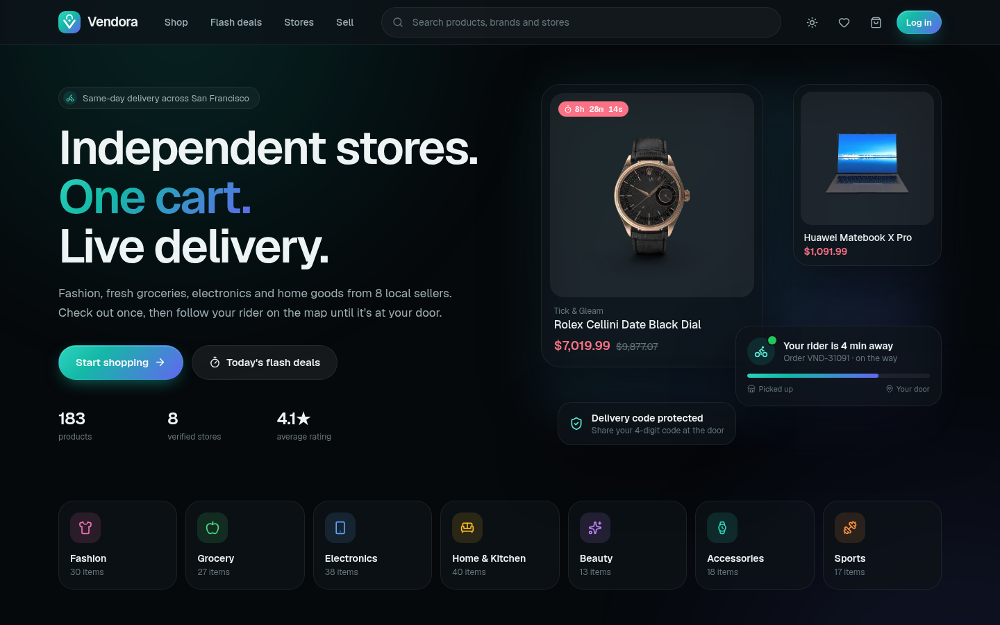

## What's new in 2.0

Vendora 2.0 merges five separate course e-commerce projects into one product and rebuilds it from the ground up:

| Came from | What it brought |
|---|---|
| GoCart (multi-vendor, Next.js) | Stores with admin approval, coupons, ratings, AI product descriptions, seller dashboard |
| Forever (MERN fashion store) | Size variants, collection filters and sorting, multi-image product pages |
| Grocery Delivery Live Tracking | Riders, live map tracking, delivery OTP, status history, flash deals |
| Greencart (grocery store) | Grocery departments, pack sizes, saved addresses, seller order handling |
| QuickCart (Next.js store) | Covered entirely by the above, folded in |

On top of the merge:

- **Neon Postgres + Prisma** instead of three different MongoDB setups
- **Better Auth** (self-hosted, no third-party account) instead of Clerk and hand-rolled JWTs
- An **editorial redesign**: warm ivory and deep forest green, Instrument Serif headlines with Inter for everything you shop with, art-directed lifestyle photography, fine borders instead of glass and gradients, and an optional dark evening theme. Responsive from 390 px phones to wide desktops
- **Real checkout logic**: server-side price, size and stock checks, stock reserved in a transaction, per-store orders and delivery fees, coupon expiry enforced, Stripe payments verified with Stripe before orders count as paid
- **One shared design system** and loading skeletons, empty states, toasts and keyboard-friendly controls on every screen

## Design

Editorial luxury meets Swiss precision: a calm grid, generous spacing and real photography, so the products and stores carry the page.

| Token | Value | Used for |
|---|---|---|
| Ivory | `#F7F5EF` | Page background |
| Cream | `#EEE9DF` | Secondary panels |
| Forest | `#0E3B2E` | Primary buttons, selected states, brand moments |
| Ink | `#171916` | Text |
| Charcoal | `#656761` | Secondary text |
| Warm grey | `#DDD9D0` | Borders |
| Sale red | `#D83A36` | Sale prices and discount badges |

- **Type:** Instrument Serif for the hero and campaigns, DM Serif Display for the wordmark and section titles, Inter for navigation, prices and controls
- **Shape:** 6–10 px radii on cards and inputs, pill buttons, hairline borders, almost no shadow
- **Motion:** slight image zoom on hover, colour transitions, nothing that loops; `prefers-reduced-motion` respected
- **Homepage:** a three-slide hero (iPhone 17 Pro, MacBook Pro M5, Kirana Corner) with real prices from the catalog, keyboard controls and autoplay that pauses on hover and for reduced motion; serif section titles with subtitles
- **Product photography:** new products have their backgrounds removed (rembg, ISNet) so cut-outs sit cleanly in the catalog; the original lifestyle photo follows in the gallery and leads on the New launches cards
- **Header:** forest announcement bar (the live coupon and the real free-delivery rule), Categories dropdown, search, and a delivery-address picker that sets your default address for checkout
- **Dark theme:** opt-in from the footer or dashboards, saved per browser and applied before first paint

All tokens live in `src/app/globals.css`.

## Built for India

- **Rupees everywhere:** prices, delivery fees and coupons in ₹ with Indian digit grouping (₹1,34,900) and compact lakh figures on dashboards
- **All states and union territories** in the address form, loaded live from the CountriesNow API (with a bundled fallback), plus city suggestions per state
- **PIN code lookup:** type a 6-digit PIN and the city and state fill in from the India Post directory (api.postalpincode.in), with tappable locality suggestions
- **Map placement by PIN:** addresses without a GPS pin are placed with OpenStreetMap Nominatim so the delivery map still works
- **+91 mobile numbers** validated and formatted on the server; only Indian addresses are accepted
- **Delivery rule:** free delivery on each store's items over ₹499, otherwise ₹49

## Features

**Shoppers**
- Search across products, brands, tags and store names; filter by department, type, price, rating, flash deals and stock; sort and paginate (all in the URL)
- Product pages with image gallery and lightbox, size picker, quantity, wishlist, full review breakdown and related items
- Flash deals with live countdowns on the home page, deals page and product cards
- One cart across stores, grouped by seller, with a free-delivery progress hint per store and coupon codes
- Guest cart in the browser, merged into the account cart on login
- Checkout with saved addresses (add one inline, optional "use my location" pin), cash on delivery or Stripe card payments
- Order tracking: status timeline, store/home/rider on an OpenStreetMap map that updates every 5 seconds, rider card with call button, and the delivery code
- Cancel before packing, rate items after delivery, wishlist and address book

**Sellers**
- Apply to open a store; admins review every application
- Dashboard: 30-day revenue, orders needing attention, rating, live deals, 14-day revenue chart, low-stock alerts, latest orders
- Products: add/edit with up to 6 photos, sizes, pack size, pricing with discount preview; inline stock editing, hide/show, delete (products with past orders are hidden instead)
- **Write with AI**: drafts the name, description, brand and tags from the cover photo (any OpenAI-compatible API, e.g. Gemini's free tier)
- Flash deals: pick a discount and a duration, end early any time
- Orders board: confirm, pack or cancel (stock restored), see the rider and timeline
- **Inventory** table: every product with its SKU, stock, status (in stock, low, out, slow mover, hidden), units sold in 30 days, days of stock left and a suggested next step ("Restock 7", "Run a flash deal")
  - Restock one product or a bulk selection, with an optional note such as a supplier invoice
  - Stock count mode: type what is on the shelf, see the difference in red or green, apply all corrections at once
  - Import counts from a spreadsheet (`SKU,Counted` CSV) and export the whole table as CSV
  - Per-product alert level, a sidebar badge for low stock, and a stock history ledger (opening stock, sales, cancellations, restocks, counts, edits) with the balance after each change

**Riders**
- Go online, accept packed orders (atomic, so two riders can't claim the same one), confirm pickup
- Share live GPS, or run the route simulator for demos
- Complete a delivery only with the customer's code; cash to collect is shown

**Admins**
- Overview: sales, applications, customers, riders online, sales chart, orders by status, top stores
- Approve, reject, pause and resume stores; assign riders to packed orders
- Read-only inventory across every live store, with the same filters and CSV export
- Add rider accounts, create and delete coupons, browse customers and their spend

## Tech stack

| Area | Choice |
|---|---|
| Framework | Next.js 16 (App Router, Server Components, Server Actions), React 19 |
| Database | PostgreSQL on Neon, Prisma ORM |
| Auth | Better Auth (email + password, optional Google), roles stored in the database |
| Styling | Tailwind CSS v4 on top of CSS design tokens, Instrument Serif + Inter (next/font), lucide-react icons |
| Maps | Leaflet + react-leaflet with OpenStreetMap tiles (no API key) |
| Charts | Recharts |
| Payments | Stripe Checkout (optional, test mode) and cash on delivery |
| Images | Cloudinary unsigned uploads (optional) or pasted image links |
| AI | Any OpenAI-compatible chat API with vision (optional) |
| Toasts | Sonner |

## Project structure

```
vendora/
├── prisma/schema.prisma        # data model (Better Auth tables + marketplace)
├── scripts/seed.mjs            # demo data seeder
├── src/
│   ├── proxy.js                # redirects signed-out visitors away from private areas
│   ├── actions/                # server actions: cart, orders, address, seller, inventory, rider, admin, wishlist
│   ├── app/
│   │   ├── (shop)/             # storefront: home, shop, product, deals, stores, cart, checkout, account
│   │   ├── seller/             # seller hub
│   │   ├── admin/              # admin console
│   │   ├── rider/              # rider app
│   │   ├── login/              # split-screen auth page
│   │   ├── api/                # Better Auth, live order status, Stripe webhook
│   │   └── globals.css         # design tokens + component classes
│   ├── components/             # ui/, layout/, product/, cart/, orders/, map/, seller/, inventory/, admin/, rider/, dashboard/
│   └── lib/                    # prisma, auth, session guards, pricing, queries, orders, inventory, upload, theme, format
└── docs/screenshots/
```

## Getting started

### Prerequisites

- Node.js 20 or newer
- A Postgres database: a free [Neon](https://neon.tech) project, or local Postgres (e.g. `docker run -p 5432:5432 -e POSTGRES_PASSWORD=postgres postgres:17-alpine`)

### 1. Clone and install

```bash
git clone https://github.com/Yusuf-Hussain25/vendora.git
cd vendora
npm install
```

### 2. Configure `.env`

```bash
cp .env.example .env
```

Every key is documented in `.env.example`. The minimum is:

| Key | Where to get it |
|---|---|
| `DATABASE_URL` | Neon → your project → **Connect** → *Pooled connection* string |
| `DIRECT_URL` | Same dialog with the pooler toggle **off** (used by `prisma db push`) |
| `BETTER_AUTH_SECRET` | Any long random string: `openssl rand -base64 32` |
| `BETTER_AUTH_URL`, `NEXT_PUBLIC_APP_URL` | `http://localhost:3000` locally, your deployed URL in production |

If something required is missing, the app shows a readable error naming the setting instead of a blank page.

### 3. Create the tables and add demo data

```bash
npx prisma db push
npm run seed
```

### 4. Run

```bash
npm run dev     # http://localhost:3000
```

`npm run lint` and `npm run build` should both pass.

## Configurable providers

Everything beyond the database and auth secret is optional. Features switch on when their keys are present.

| Feature | Keys | Without them |
|---|---|---|
| Image uploads | `NEXT_PUBLIC_UPLOAD_PROVIDER=cloudinary`, `NEXT_PUBLIC_CLOUDINARY_CLOUD_NAME`, `NEXT_PUBLIC_CLOUDINARY_UPLOAD_PRESET` | Sellers paste HTTPS image links (`url` provider, the default) |
| Card payments | `STRIPE_SECRET_KEY`, `STRIPE_WEBHOOK_SECRET` | Cash on delivery only; the card option is hidden |
| AI listing assistant | `AI_API_KEY`, `AI_BASE_URL`, `AI_MODEL` | The "Write with AI" button is hidden |
| Google sign-in | `GOOGLE_CLIENT_ID`, `GOOGLE_CLIENT_SECRET` | Email and password only |
| Currency | `NEXT_PUBLIC_CURRENCY` (default `INR`) | Indian rupees |

**Cloudinary**: Settings → Upload → Upload presets → *Add upload preset* → Signing mode **Unsigned**, folder `vendora`. Only the cloud name and preset name go in `.env`; the API secret is never needed.

**Stripe**: use test-mode keys. Orders paid by card are confirmed on the success page by asking Stripe directly, and the webhook (`/api/stripe/webhook`, event `checkout.session.completed`) does the same in the background. Abandoned card checkouts release their reserved stock.

**AI**: the free option is a Google AI Studio key with `AI_BASE_URL=https://generativelanguage.googleapis.com/v1beta/openai/` and `AI_MODEL=gemini-2.5-flash`. Any OpenAI-compatible endpoint with image input works.

## Demo data

`npm run seed` builds a believable Indian marketplace:

- 9 approved stores in **Bengaluru** (Indiranagar, Koramangala, Jayanagar, HSR Layout) and **Mumbai** (Andheri, Bandra, Lower Parel, Colaba), plus a pending application from Pune
- **250+ products in rupees:** the current Apple line-up (iPhone 17 Pro Max, iPhone Air, iPhone 17, MacBook Pro M5, MacBook Air M4, iMac, Mac mini, iPads, AirPods, Apple Watch), Galaxy S25 Ultra, Z Fold7 and Z Flip7, Pixel 10 Pro, OnePlus 13 and PS5 Pro; Indian pantry brands such as Parle-G, Britannia, Amul, Tata, Maggi and Balaji with real pack photos; and the DummyJSON catalog for fashion, beauty, home and sports
- Live flash deals, sizes for clothes and shoes, pack sizes for groceries
- 12 shoppers and 3 riders with +91 numbers and real localities and PIN codes; live orders always pair a store and shopper in the same city, so the rider map makes sense
- 120 orders over the last 30 days in every status, reviews, and 4 coupons in ₹ (one expired)
- A SKU for every product (`VND-1001` onwards) and a stock history that starts with the opening stock and lists every sale, so the ledger always adds up to the stock shown

The demo logins come from `.env` only:

| Key | Account |
|---|---|
| `NEXT_PUBLIC_DEMO_EMAIL` | Shopper who also owns the Threadline Studio store |
| `NEXT_PUBLIC_DEMO_RIDER_EMAIL` | Rider with an active delivery |
| `NEXT_PUBLIC_DEMO_ADMIN_EMAIL` | Admin |
| `NEXT_PUBLIC_DEMO_PASSWORD` | Shared password for the three demo logins |
| `SEED_PASSWORD` | Password for every other seeded account |
| `ADMIN_EMAIL` / `ADMIN_PASSWORD` | Your own private admin account (re-running the seeder applies a changed password) |

When the demo email and password are set, the login page shows **Explore with a demo account** with a role picker. The seeder is safe to re-run: it reuses existing records and refreshes flash deals so they're always live. Use `npm run seed -- --with you@example.com` to add orders, an address and wishlist items to your own account (sign up first).

## Security

- Every server action and API route checks the session and role **from the database** (roles can't be set through sign-up)
- Shoppers only see their own orders; the live-tracking API answers only the buyer, the store, the assigned rider or an admin
- Prices, sizes, stock and coupons are re-validated on the server at checkout; stock is reserved atomically so it can't go below zero
- Every stock change is written to the history in the same transaction as the change itself; sellers can only restock, count or view the history of their own products
- Riders claim deliveries atomically and can only complete them with the customer's code
- Card orders are marked paid only after Stripe confirms the payment; the webhook verifies Stripe's signature
- Products and stores that aren't approved and active never appear to shoppers
- No secrets in the client bundle: only `NEXT_PUBLIC_` values (public by design) reach the browser

## Deployment (Vercel)

1. Push the repo to GitHub and import it in Vercel. The framework preset is **Next.js** (no `vercel.json` is needed: Next.js routing works out of the box).
2. Add the environment variables from `.env` in *Settings → Environment Variables*. Set `BETTER_AUTH_URL` and `NEXT_PUBLIC_APP_URL` to your Vercel URL.
3. Deploy. The build runs `prisma generate && next build`.
4. Run `npx prisma db push` and `npm run seed` once against the production `DATABASE_URL` from your machine.
5. If you use Stripe, add the webhook endpoint `https://<your-app>/api/stripe/webhook` and copy its signing secret into `STRIPE_WEBHOOK_SECRET`.

## Screenshots

| | |
|---|---|
| 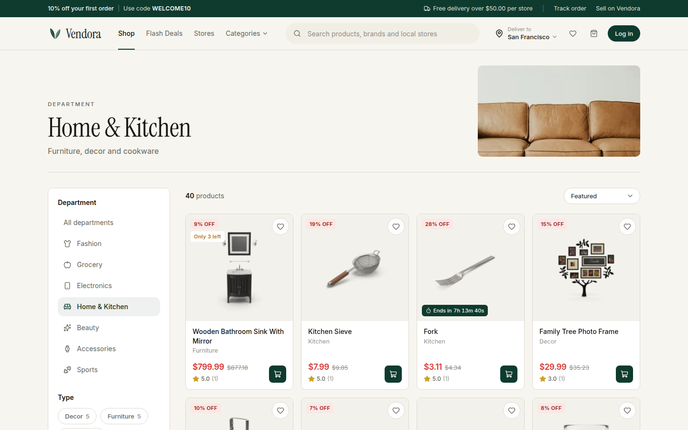 | 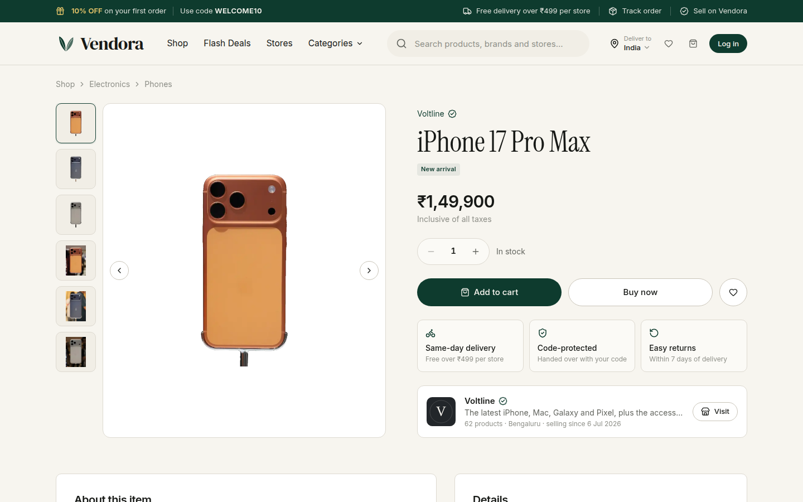 |
| 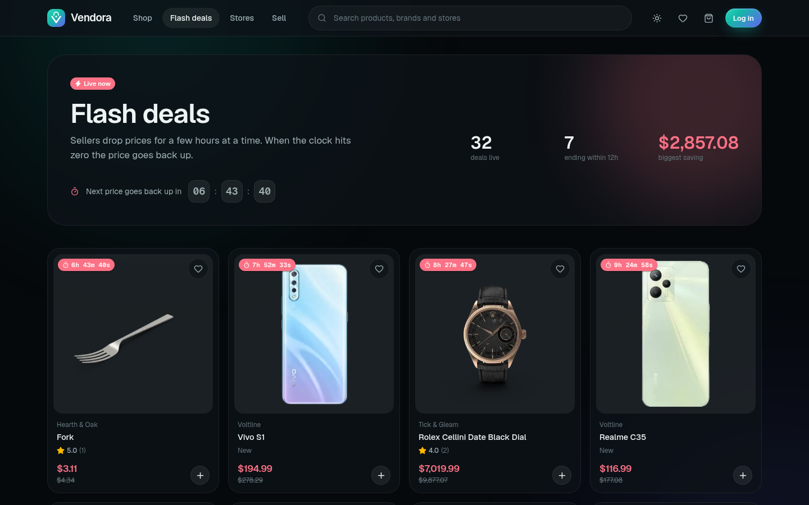 | 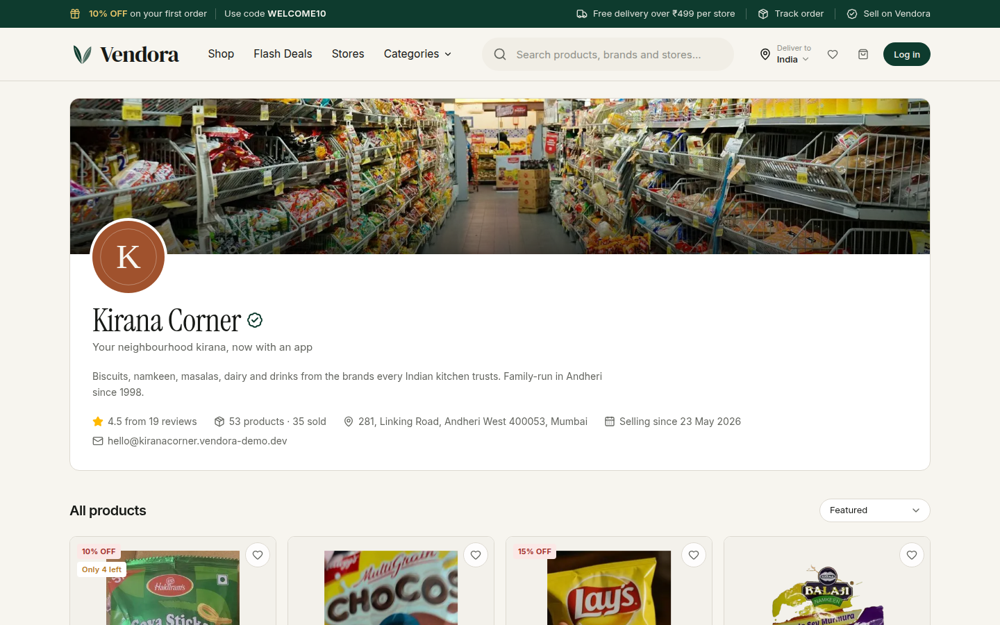 |
| 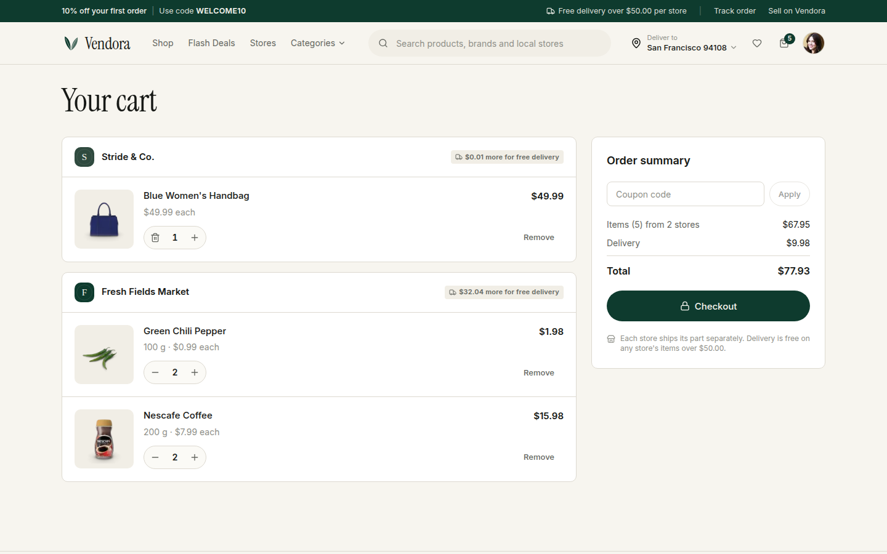 | 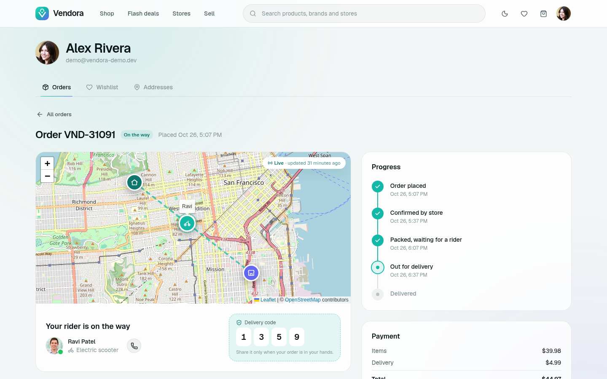 |
| 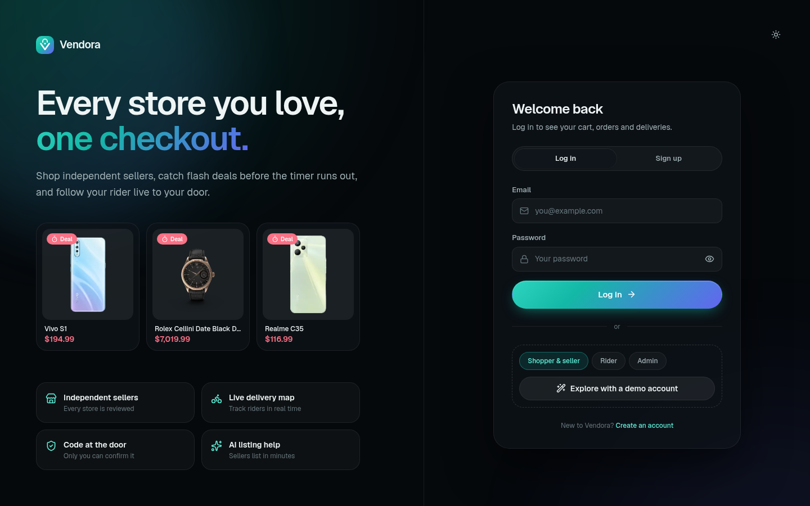 | 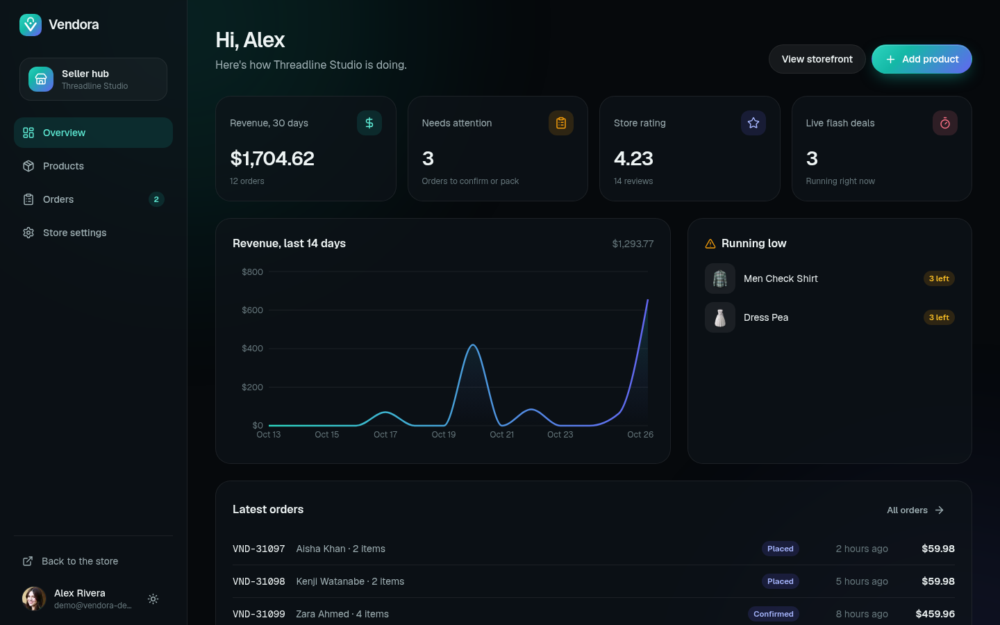 |
| 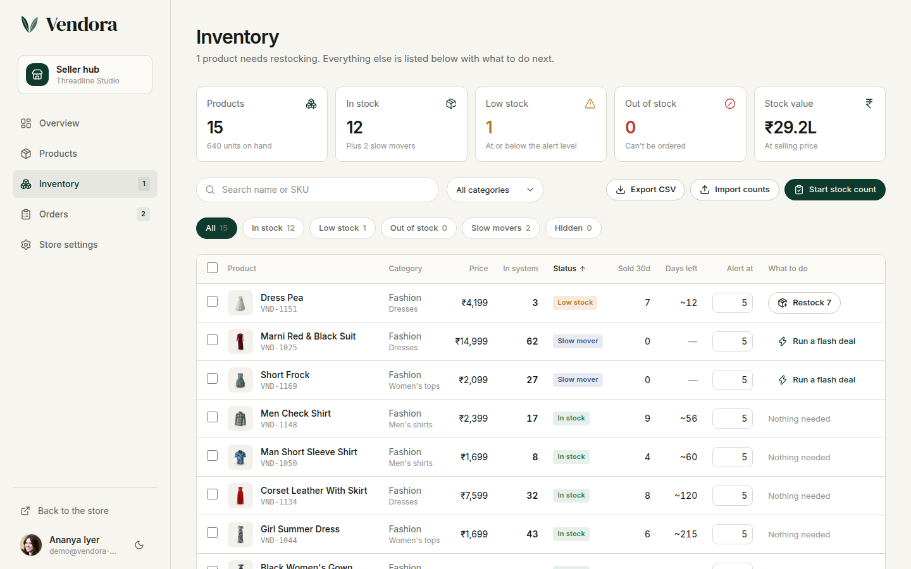 | 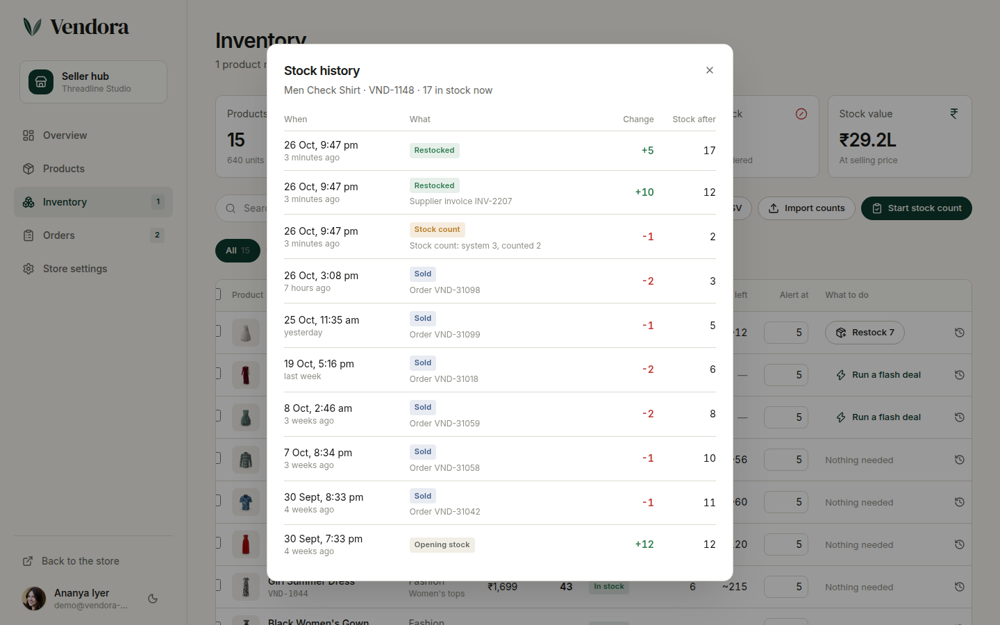 |
| 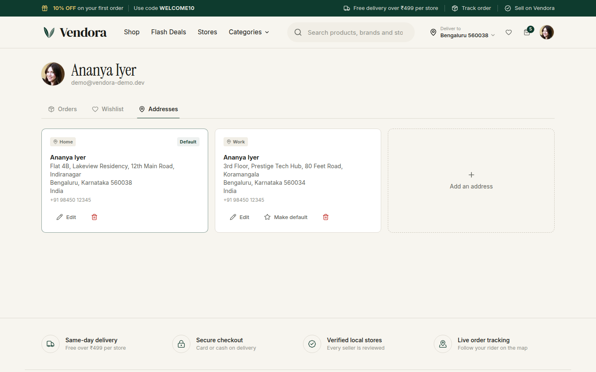 |  |
| 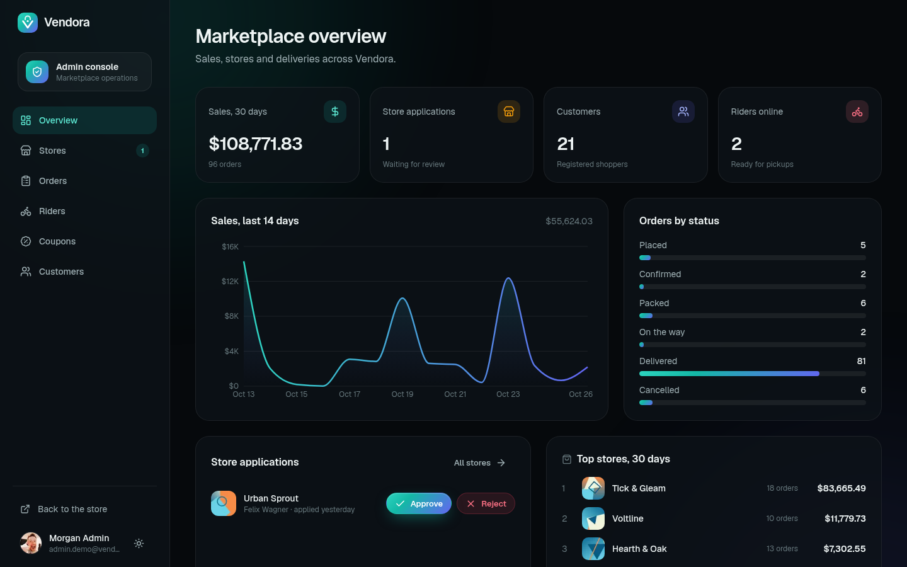 | 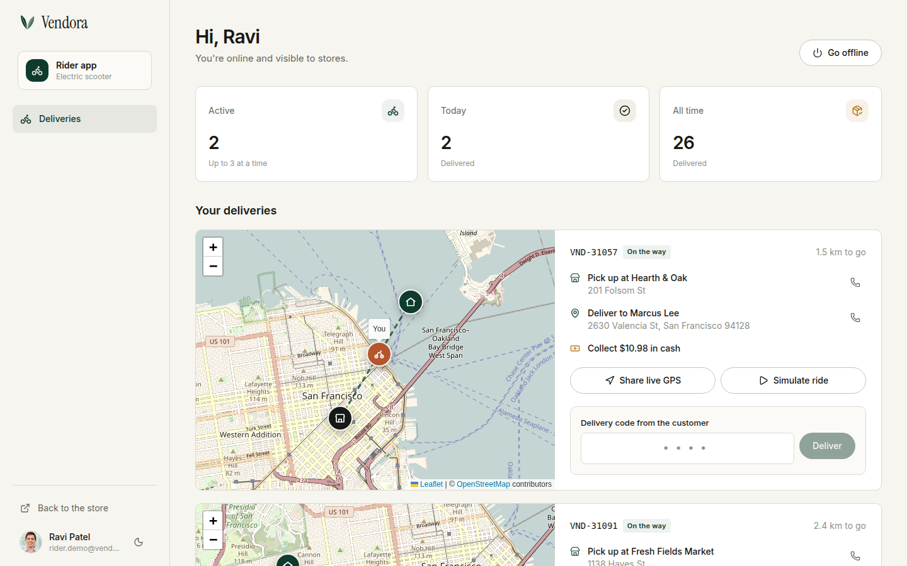 |

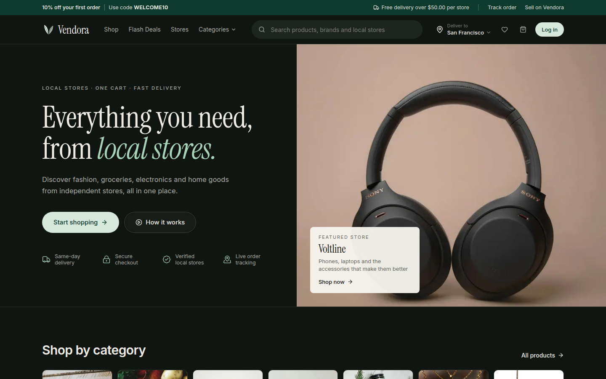

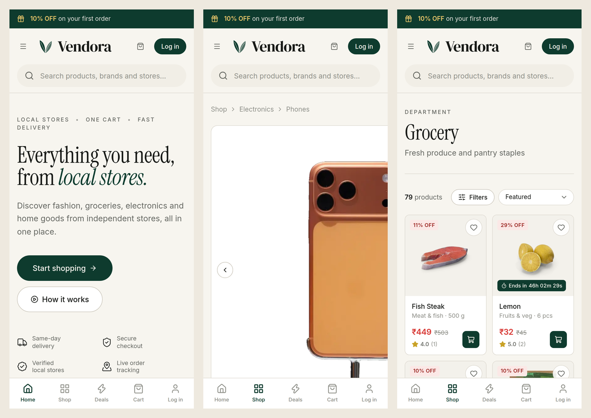

<details>
<summary>Full home page</summary>

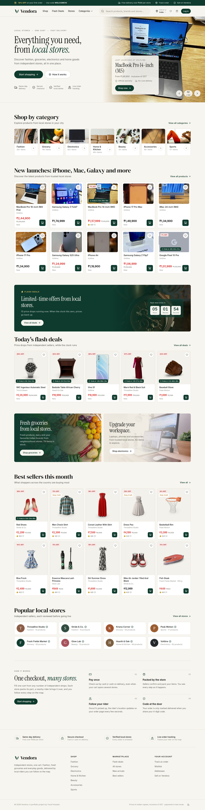

</details>

## Credits

Electronics photos come from [Wikimedia Commons](https://commons.wikimedia.org) (CC0 / CC BY / CC BY-SA, authors and licences in `public/products/CREDITS-electronics.json`); Indian grocery data and pack photos from [Open Food Facts](https://world.openfoodfacts.org) (ODbL / CC BY-SA, `public/products/CREDITS-grocery.json`); other product names, photos and review snippets from [DummyJSON](https://dummyjson.com); lifestyle and store photography from [Unsplash](https://unsplash.com) (sources listed in `public/images/CREDITS.json`); portraits from [randomuser.me](https://randomuser.me); map data © [OpenStreetMap](https://www.openstreetmap.org/copyright) contributors. Built on ideas from five course projects, merged, rewritten and redesigned.

## Author

**Yusuf Hussain** · https://github.com/Yusuf-Hussain25
